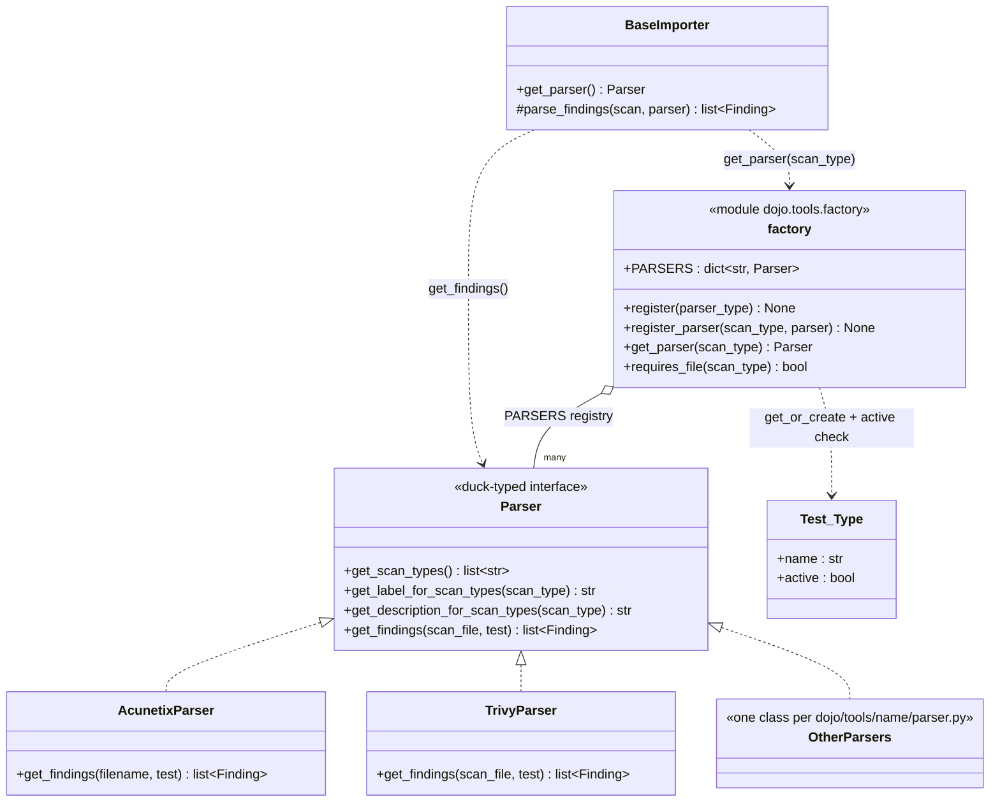
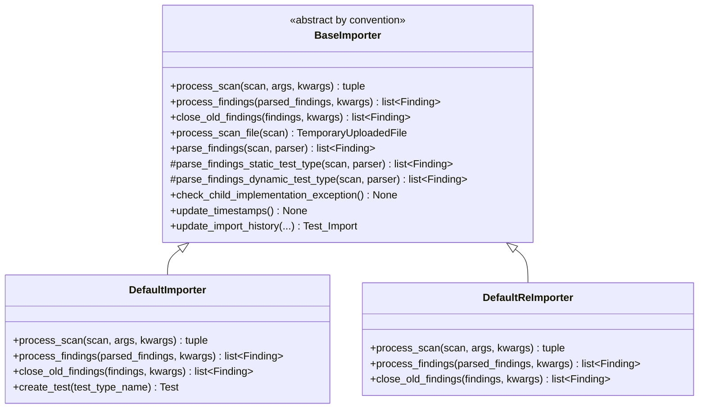
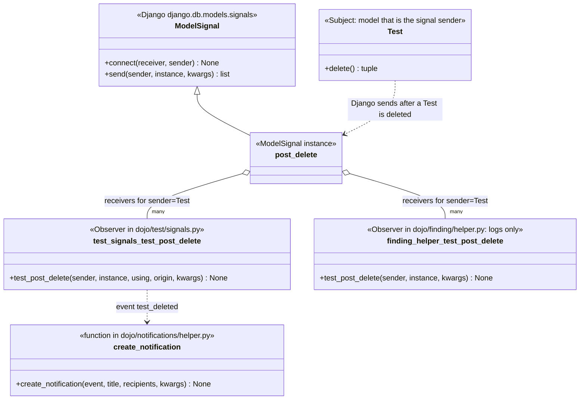
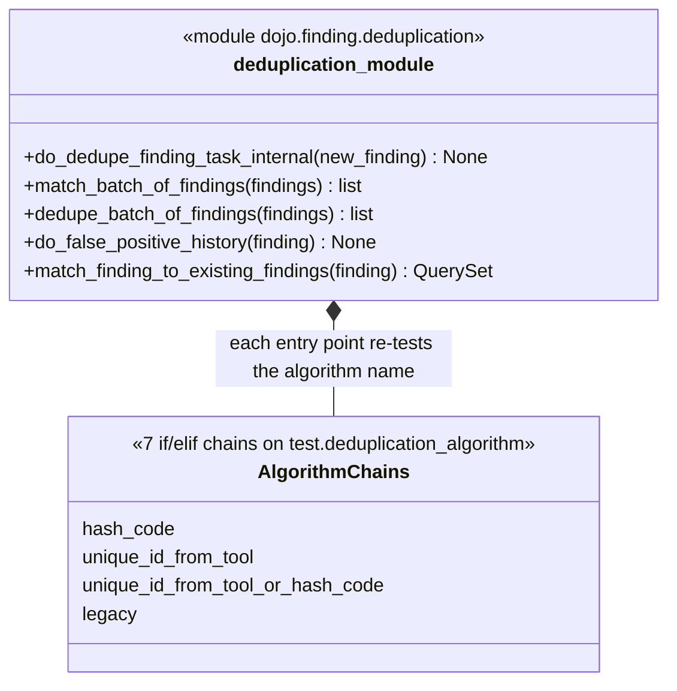
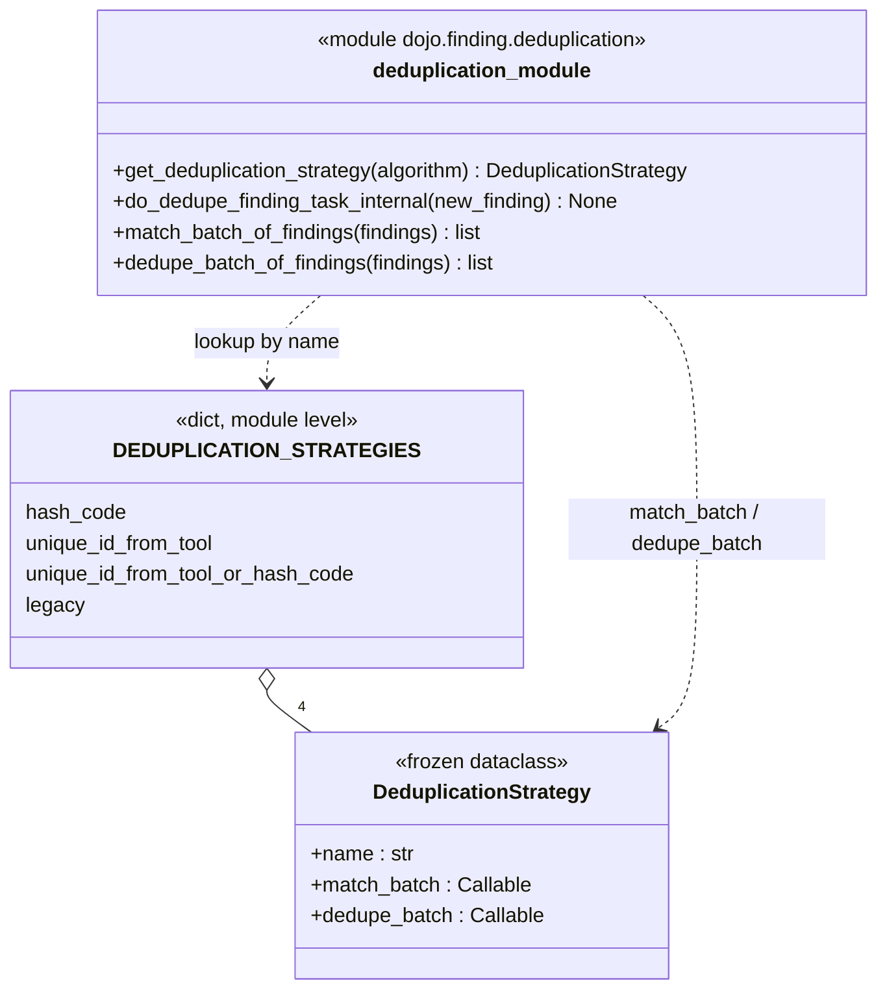

# Design Patterns

CSCI 360: Software Architecture, Security, and Testing | Fall 2026 - Tyler McGuire

Prepared with Claude Code (Anthropic), run inside the local clone of this fork. Every file, class, function and line number cited below was read in this repository, not recalled from general knowledge of DefectDojo. Line numbers for "before" code refer to `master` at `b1207e5ed`; line numbers for "after" code refer to the commits linked below. Full disclosure is in the AI Use Log at the bottom.

**Commits**

- Part 3 (pattern): [`77d65a7`](https://github.com/tlmcguire/django-DefectDojo/commit/77d65a7e2d78b94c72ae5d563c72501cc2b2a07a) - `A8: Apply Strategy to deduplication algorithm dispatch in dojo/finding/deduplication.py`
- Part 4 (GRASP): [`aab30be`](https://github.com/tlmcguire/django-DefectDojo/commit/aab30be9fc6b876e98133b6335f525606ca5bd0f) - `A8-GRASP: Refactor finding duplicate-cluster functions to apply Low Coupling`

Diagram sources are committed in [`class-docs/`](../class-docs) (this fork keeps course material there so it does not mix with DefectDojo's own `/docs` Hugo site): `pattern-factory-parsers.mmd`, `pattern-template-method-importer.mmd`, `pattern-observer-signals.mmd`, `missing-pattern-strategy-before.mmd`, `missing-pattern-strategy-after.mmd`.

---

## Part 1: Three GoF Patterns Already in the Project

### Pattern 1: Factory (a registry-backed Simple Factory) - parsers

**Roles.**

| Role | Class / module |
|---|---|
| Factory | `dojo/tools/factory.py` (`register`, `register_parser`, `get_parser`) |
| Product interface | the parser contract: `get_scan_types`, `get_label_for_scan_types`, `get_description_for_scan_types`, `get_findings(scan_file, test)` (duck-typed; documented by the `Parser` stub in `dojo/importers/base_importer.py:54`) |
| Concrete products | one class per `dojo/tools/<name>/parser.py`, e.g. `AcunetixParser`, `TrivyParser` (roughly 250 scanner directories) |
| Client | `BaseImporter.get_parser()` (`dojo/importers/base_importer.py:233`) |



```python
# dojo/tools/factory.py:33
def get_parser(scan_type):
    """Return a parser by the scan type"""
    if scan_type not in PARSERS:
        raise ValueError(f"Parser '{scan_type}' does not exist")
    test_type, _ = Test_Type.objects.get_or_create(name=scan_type)
    if test_type.active:
        return PARSERS[scan_type]
    raise ValueError(f"Parser {scan_type} is not active")

# dojo/tools/factory.py:110 - parsers are discovered, not imported by name
for module_name in os.listdir(package_dir):
    ...
    register(attribute)   # every class named <Dir>Parser in dojo/tools/<dir>/parser.py
```

**Problem it solves here.** The importer is handed a string (`"Trivy Scan"`) from an upload form or an API call and must run the matching parser without knowing any parser exists. The factory is the only place that maps that string to an object, and it also enforces a DefectDojo-specific rule no plain factory has: a scan type whose `Test_Type` row has `active=False` cannot be imported. Without it, `BaseImporter`, `DefaultImporter` and `DefaultReImporter` would each need an import line and a branch per scanner (roughly 250), and adding a scanner would mean editing the importers; today it means dropping a folder into `dojo/tools/`.

### Pattern 2: Template Method - the importers

**Roles.**

| Role | Class |
|---|---|
| Abstract class | `BaseImporter` (`dojo/importers/base_importer.py:72`) |
| Template (fixed skeleton) | `BaseImporter.parse_findings` (`:358`), which calls the overridable hook `process_scan_file` (`:241`) and then picks `parse_findings_static_test_type` (`:251`) or `parse_findings_dynamic_test_type` (`:344`) |
| Abstract steps | `process_scan` (`:192`), `process_findings` (`:205`), `close_old_findings` (`:217`); each calls `check_child_implementation_exception()` (`:180`), which raises `NotImplementedError` if the base class itself is used |
| Concrete classes | `DefaultImporter` (`default_importer.py:47`) and `DefaultReImporter` (`default_reimporter.py:72`) |



```python
# dojo/importers/base_importer.py:358
def parse_findings(self, scan, parser):
    scan = self.process_scan_file(scan)            # hook: base returns scan unchanged
    if hasattr(parser, "get_tests"):               # fixed decision
        parsed_findings = self.parse_findings_dynamic_test_type(scan, parser)
    else:
        parsed_findings = self.parse_findings_static_test_type(scan, parser)
    return parsed_findings

# dojo/importers/base_importer.py:205
def process_findings(self, parsed_findings, **kwargs):
    self.check_child_implementation_exception()    # abstract step: subclasses must override
```

**Problem it solves here.** A first import and a re-import are the same pipeline with different middles: both verify tool configuration, fetch a parser, parse, save, close old findings, update timestamps and import history, and notify, but "save" means create-everything for one and match-against-existing-and-diff for the other. The base class owns what is identical (parse strategy, tag handling, import-history records, severity sanitising, `save_without_resurrecting`, ...) and the subclasses own only the steps that differ. Without it, the 1,300-line base class's shared helpers would be duplicated or one importer would be a giant `if reimport:` class. One honest limit: `process_scan` itself is abstract and each subclass writes its own sequence of steps (`default_importer.py:93`, `default_reimporter.py:91`), so the skeleton is only partly enforced by the base. The parse step is a true template; the top-level order is a convention.

### Pattern 3: Observer - Django signals reacting to model changes

**Roles.**

| Role | Class / function |
|---|---|
| Subject (event source) | the model class `Test`, which Django sends `post_delete` for; the dispatcher is `django.dispatch.Signal` / `ModelSignal` |
| Observers | functions registered with `@receiver(post_delete, sender=Test)`: `test_post_delete` in `dojo/test/signals.py:17` and `test_post_delete` in `dojo/finding/helper.py:897` |
| What an observer triggers | `create_notification(event="test_deleted", ...)` (`dojo/notifications/helper.py:65`) |



```python
# dojo/test/signals.py:17
@receiver(post_delete, sender=Test)
def test_post_delete(sender, instance, using, origin, **kwargs):
    ...
    create_notification(event="test_deleted",
                        title=_("Deletion of %(name)s") % {"name": str(instance)},
                        recipients=[instance.engagement.lead], ...)
```

**Problem it solves here.** `Test` can be deleted from at least three places: the UI view (`dojo/test/ui/views.py:295`), the REST viewset (`dojo/test/api/views.py:73`), and the cascade when an Engagement or Product is deleted. If each caller had to remember "also notify the engagement lead, also clean up notes and files, also reconfigure duplicate clusters", one forgotten call would leave orphaned rows or a missing notification. With signals, the model announces "I was deleted" and each concern (notifications, file cleanup, duplicate handling) registers itself in its own module. The project leans on this heavily (53 `@receiver` uses under `dojo/`, wired from `dojo/apps.py`). The cost is that control flow is invisible at the call site, which is why `dojo/apps.py` has to import every `signals.py` explicitly.

---

## Part 2: A Pattern That Is Missing - Strategy for Deduplication

**Where.** `dojo/finding/deduplication.py` on `master` (`b1207e5ed`). Each Test has a `deduplication_algorithm` (`hash_code`, `unique_id_from_tool`, `unique_id_from_tool_or_hash_code`, or `legacy`), and the module chose the algorithm with a hand-written `if/elif` on that string in **seven separate places**:

| Line | Function | What the chain picks |
|---|---|---|
| 95 | `do_dedupe_finding_task_internal` | single-finding dedupe |
| 912 | `match_batch_of_findings` | match-only batch |
| 1034 | `dedupe_batch_of_findings` | match-and-persist batch |
| 1066 | `_fp_candidates_qs` | false-positive-history candidate query |
| 1137 | `_fetch_fp_candidates_for_batch` | false-positive-history candidate lookup |
| 1203 | `do_false_positive_history_batch` | per-algorithm matching |
| 1306 | `match_finding_to_existing_findings` | candidate query |

```python
# dojo/finding/deduplication.py:95 (master)
if deduplicationAlgorithm == settings.DEDUPE_ALGO_UNIQUE_ID_FROM_TOOL:
    deduplicate_unique_id_from_tool(new_finding)
elif deduplicationAlgorithm == settings.DEDUPE_ALGO_HASH_CODE:
    deduplicate_hash_code(new_finding)
elif deduplicationAlgorithm == settings.DEDUPE_ALGO_UNIQUE_ID_FROM_TOOL_OR_HASH_CODE:
    deduplicate_uid_or_hash_code(new_finding)
else:
    deduplicate_legacy(new_finding)
```

**Concrete problem today.**

- **Shotgun surgery.** Adding a fifth algorithm means finding and editing all seven chains. Miss one and that path silently falls through to `legacy`, because every chain ends with a default branch.
- **Inconsistency already exists.** Three chains compare against `settings.DEDUPE_ALGO_*` and four against the string literals (`"hash_code"`, `"legacy"`), and the chains are not in the same order, so the "else" case is subtly different from place to place.
- **The module is closed to extension.** Behaviour for a new algorithm lives scattered through unrelated functions instead of in one unit.

**Pattern that fixes it: Strategy.** Each algorithm becomes an interchangeable object with the same interface (`match_batch`, `dedupe_batch`), held in a registry keyed by the algorithm name. Callers ask the registry for the strategy and call it; they never test the name again. The algorithm functions already existed (`match_batch_hash_code`, `_dedupe_batch_hash_code`, ...), so the work is naming the interface and removing the conditionals.

**GRASP connection.** The chains violate **Protected Variations**: the code is not shielded from the variation point "which algorithm", so every new algorithm changes many callers. They also work against **Polymorphism** (GRASP's own advice: when behaviour varies by type, assign the responsibility to the variants rather than branching on type). Strategy restores both: the variation point is hidden behind one stable interface, and each variant answers for itself.

---

## Part 3: Implementation (Strategy)

Commit [`77d65a7`](https://github.com/tlmcguire/django-DefectDojo/commit/77d65a7e2d78b94c72ae5d563c72501cc2b2a07a): `A8: Apply Strategy to deduplication algorithm dispatch in dojo/finding/deduplication.py`. It changes `dojo/finding/deduplication.py` and adds `unittests/test_dedupe_strategy_registry.py`.

**Before** (class diagram: `missing-pattern-strategy-before.mmd`)



```python
# dojo/finding/deduplication.py:1034, dedupe_batch_of_findings (master)
dedup_alg = test.deduplication_algorithm
if dedup_alg == settings.DEDUPE_ALGO_HASH_CODE:
    logger.debug(f"deduplicating finding batch with DEDUPE_ALGO_HASH_CODE - {len(findings)} findings")
    return _dedupe_batch_hash_code(findings)
if dedup_alg == settings.DEDUPE_ALGO_UNIQUE_ID_FROM_TOOL:
    logger.debug(f"deduplicating finding batch with DEDUPE_ALGO_UNIQUE_ID_FROM_TOOL - {len(findings)} findings")
    return _dedupe_batch_unique_id(findings)
if dedup_alg == settings.DEDUPE_ALGO_UNIQUE_ID_FROM_TOOL_OR_HASH_CODE:
    logger.debug(f"deduplicating finding batch with DEDUPE_ALGO_UNIQUE_ID_FROM_TOOL_OR_HASH_CODE - {len(findings)} findings")
    return _dedupe_batch_uid_or_hash(findings)
logger.debug(f"deduplicating finding batch with LEGACY - {len(findings)} findings")
return _dedupe_batch_legacy(findings)
```

**After** (class diagram: `missing-pattern-strategy-after.mmd`)



```python
# dojo/finding/deduplication.py:1002 - the Strategy interface and its registry
@dataclass(frozen=True)
class DeduplicationStrategy:
    name: str
    match_batch: Callable
    dedupe_batch: Callable

DEDUPLICATION_STRATEGIES = {
    settings.DEDUPE_ALGO_HASH_CODE: DeduplicationStrategy(
        "DEDUPE_ALGO_HASH_CODE", match_batch_hash_code, _dedupe_batch_hash_code),
    settings.DEDUPE_ALGO_UNIQUE_ID_FROM_TOOL: DeduplicationStrategy(...),
    settings.DEDUPE_ALGO_UNIQUE_ID_FROM_TOOL_OR_HASH_CODE: DeduplicationStrategy(...),
    settings.DEDUPE_ALGO_LEGACY: DeduplicationStrategy(
        "DEDUPE_ALGO_LEGACY", match_batch_legacy, _dedupe_batch_legacy),
}

def get_deduplication_strategy(algorithm):
    return DEDUPLICATION_STRATEGIES.get(algorithm, DEDUPLICATION_STRATEGIES[settings.DEDUPE_ALGO_LEGACY])

# dojo/finding/deduplication.py:1058 - dedupe_batch_of_findings, now
strategy = get_deduplication_strategy(test.deduplication_algorithm)
logger.debug(f"deduplicating finding batch with {strategy.name} - {len(findings)} findings")
return strategy.dedupe_batch(findings)

# dojo/finding/deduplication.py:906 - match_batch_of_findings, now one line
return get_deduplication_strategy(test.deduplication_algorithm).match_batch(findings)
```

**What changed.** Three of the seven chains (single-finding dedupe, match-only batch, persisting batch) now go through one registry. About 30 lines of branching became 4 registry entries and one lookup. Behaviour is preserved: the same functions run for the same algorithm names, unknown names still fall back to legacy, and the single-finding path still logs "no configuration per parser found; using legacy algorithm". The one visible difference is cosmetic: the legacy batch debug line now reads `DEDUPE_ALGO_LEGACY` instead of `LEGACY`. The four false-positive-history chains were left alone on purpose to keep this one commit reviewable; they are the next candidates for the same registry.

**What is easier to change now.** Adding a fifth algorithm for the dispatch paths means writing its two functions and adding one entry to `DEDUPLICATION_STRATEGIES`; none of the three dispatchers change. The new test file (`unittests/test_dedupe_strategy_registry.py`) fails if an algorithm is added to `settings.DEDUPE_ALGOS` without a strategy, which the old chains could not detect (they fell through to `legacy` silently).

---

## Part 4: GRASP Refactoring - Low Coupling (Pure Fabrication)

Commit [`aab30be`](https://github.com/tlmcguire/django-DefectDojo/commit/aab30be9fc6b876e98133b6335f525606ca5bd0f): `A8-GRASP: Refactor finding duplicate-cluster functions to apply Low Coupling`.

**What moved and why.** `dojo/finding/api/views.py` imported `duplicate_cluster`, `reset_finding_duplicate_status_internal` and `set_finding_as_original_internal` straight out of `dojo/finding/ui/views.py`, so the REST API depended on the template-rendering layer (this was the architectural concern in assignment A3). I moved those three functions, plus `calculate_possible_related_actions_for_similar_finding` which `duplicate_cluster` calls, into `dojo/finding/helper.py` (the module both presentation layers already share for business logic), and dropped the `request` parameter they accepted but never used. The API and UI now both depend downward on the helper, a change to a browser view can no longer silently break the API, and the functions are usable and testable without importing the 3,200-line `ui/views.py`.

```python
# before: dojo/finding/api/views.py:59 (API -> UI)
from dojo.finding.ui.views import (
    duplicate_cluster,
    reset_finding_duplicate_status_internal,
    set_finding_as_original_internal,
)
result = duplicate_cluster(request, finding)

# after: dojo/finding/api/views.py (API -> helper, same as the rest of the module)
import dojo.finding.helper as finding_helper
result = finding_helper.duplicate_cluster(finding)
```

The functions now live at `dojo/finding/helper.py:1737` (`reset_finding_duplicate_status_internal`), `:1756` (`set_finding_as_original_internal`), `:1817` (`duplicate_cluster`) and `:1838` (`calculate_possible_related_actions_for_similar_finding`). The two HTTP views that wrap them (`reset_finding_duplicate_status`, `set_finding_as_original`) stay in `ui/views.py` and call the helper.

---

## Part 5: GoF and GRASP

GRASP and GoF work at different levels of the same decision. GRASP principles ask a question about one responsibility ("who should know this, who should create that, how do I keep one change from rippling everywhere?") and give a principle for answering it; a GoF pattern is what you get when the same answer has been needed so many times that it has a name and a standard shape. In this project the dedupe dispatch shows the path from one to the other. The question was "who is responsible for choosing the algorithm?", and the original answer was "every function that needs one", which breaks Protected Variations: seven chains had to change together. Following that principle, wrap the varying part behind a stable interface and let polymorphism choose, leads directly to Strategy, and `DeduplicationStrategy` plus its registry is that principle given a concrete shape. The Part 4 refactor went the other way: no pattern name was needed, Low Coupling alone said "the API should not depend on the UI", and the fix was to put the shared behaviour in a Pure Fabrication, the helper module, which is a GRASP idea and not a GoF pattern. So GRASP tells you where a responsibility should go; a GoF pattern is sometimes the reusable mechanism that lets it get there.

---

## Part 6: Present in Class (talking points)

1. **A pattern found:** show the Factory diagram. The importer never names a scanner; `dojo/tools/factory.py` maps the scan-type string to a parser and refuses inactive scan types, so adding a scanner is dropping in a folder.
2. **The change:** open commit `77d65a7` on screen. Left side: the 12-line `if/elif` chain at `deduplication.py:1034`. Right side: `strategy = get_deduplication_strategy(...)`.
3. **One sentence:** adding a deduplication algorithm is now one registry entry instead of an edit to seven functions.

---

## AI Use Log

**Tool:** Claude Code (Anthropic), run inside this cloned fork at `/Users/tyler/Projects/django-DefectDojo`, with shell, file-edit and read access to the repository. It worked on a new branch, `coursework/a8-design-patterns`, cut from `master`, at my choice, because `master` is the released line and the project's own `AGENTS.md` blocks edits there.

**What I asked it to do, and what it did:**

1. Read the assignment `.docx` and the previous A3 write-up (`logical-architecture.md`) so this page matched the house format, and read the repo's `AGENTS.md`.
2. Searched the code for candidate patterns and read the real files before choosing: `dojo/tools/factory.py`, `dojo/importers/base_importer.py` with `default_importer.py` and `default_reimporter.py`, `dojo/test/signals.py`, `dojo/finding/helper.py`, `dojo/notifications/helper.py`, and `dojo/finding/deduplication.py`. It considered Strategy-like notification managers (`_get_manager_instance`, `dojo/notifications/helper.py:794`) and the Pluggable `NOTIFICATION_MANAGER` setting but left them out so the missing pattern did not overlap with the three found ones.
3. Chose the missing pattern by counting how many places branch on `deduplication_algorithm` (`grep` for `dedup_alg ==`), which is where the seven-chain figure comes from.
4. Implemented Strategy as one commit (code plus a new unit test) and the Low Coupling move as a separate commit, in the order the assignment requires. For the GRASP commit it reused the A3 architectural concern rather than inventing a new one.
5. Drafted this page and the five `.mmd` diagram sources. I reviewed and adjusted them before publishing.

**Honest limits, not smoothed over:**

- **The Django test suite was not run.** The Docker daemon was not running on this machine and there is no local Django install, so `./run-unittest.sh` could not run. What was done instead: `python3 -m py_compile` on every changed file; an AST check that no import became unused in the three files touched by the GRASP move; a stub-based run of the exact registry code confirming each algorithm name resolves to the right two functions and an unknown name falls back to legacy. The new `unittests/test_dedupe_strategy_registry.py` and the existing `test_deduplication_logic.py`, `test_importers_deduplication.py` and the REST API tests that exercise `/duplicate/` endpoints should be run (`./run-unittest.sh --test-case unittests.test_dedupe_strategy_registry` and the others) before anyone relies on this.
- **Mermaid diagrams were not rendered.** They were written to Mermaid's `classDiagram` grammar and checked by reading, not by viewing a rendered image.
- **Template Method is partial.** I said so in Part 1 rather than overstating it: the parse step is a real template, but `process_scan` is rewritten in each subclass.
- The Parts 3 and 4 refactors were written by the AI and reviewed by me. The pattern choices and the decision to branch off `master` were mine.
