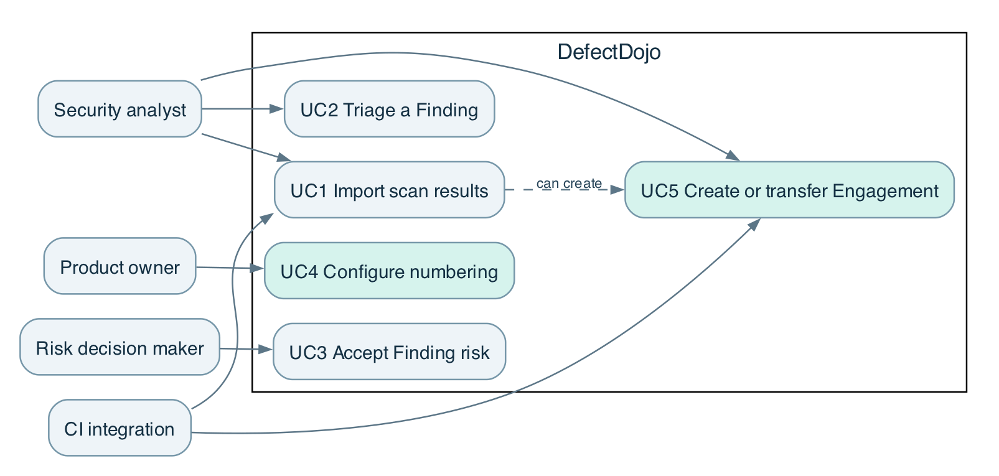
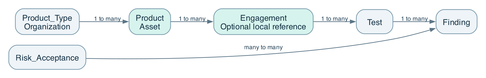
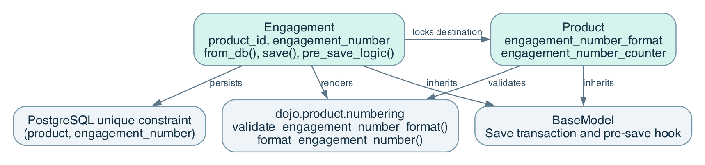
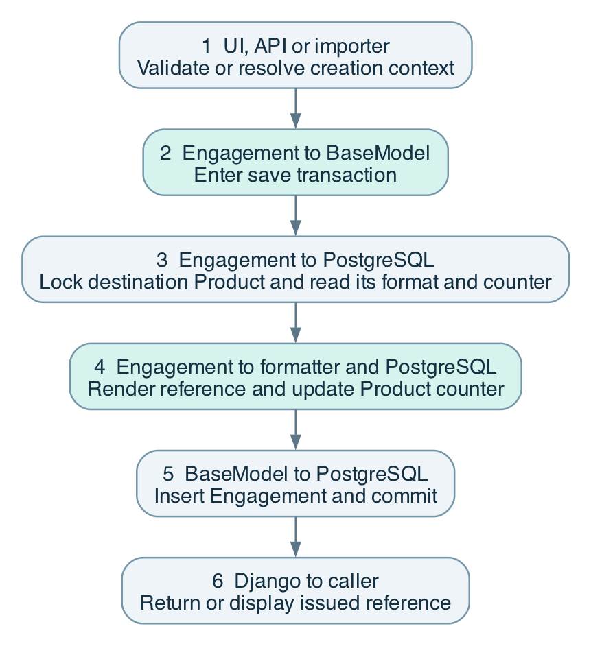
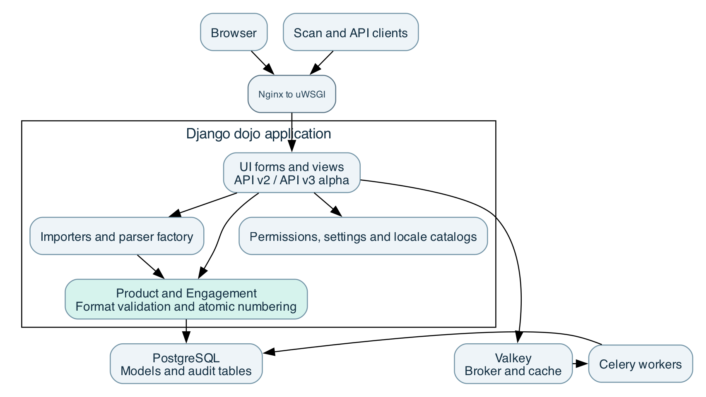
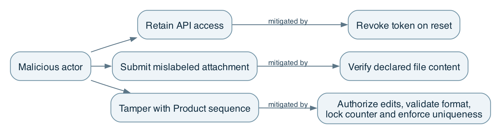
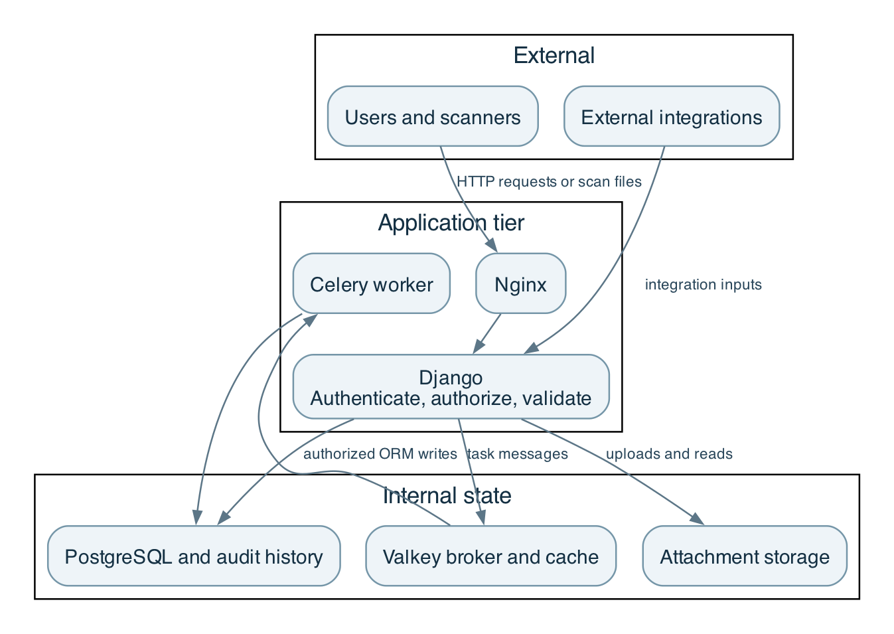
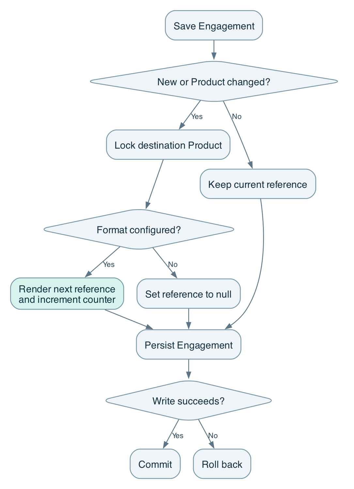
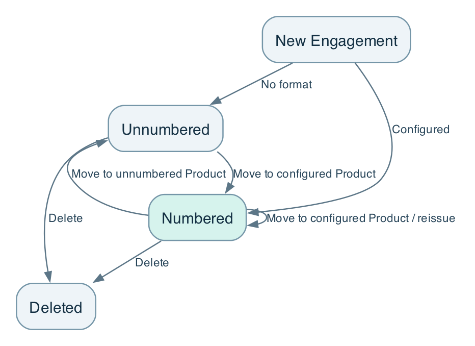

# DefectDojo Software Architecture Document

Tyler McGuire · CSCI 360 Software Architecture, Security, and Testing · Fall 2026

DefectDojo centralizes vulnerability findings from scanners and manual assessments so security teams can triage, track, and report them. This document follows one change through that system: product owners can opt into a readable, product-local Engagement reference such as `ENG-0001`. The design puts allocation inside the existing save transaction, which gives the web UI, APIs, imports, copies, and moves one numbering rule.

## Contents

1. [Introduction](#1-introduction)
2. [Use Case View](#2-use-case-view)
3. [Logical View](#3-logical-view)
4. [Architectural View](#4-architectural-view)
5. [GRASP Analysis](#5-grasp-analysis)
6. [Design Patterns](#6-design-patterns)
7. [Security Analysis](#7-security-analysis)
8. [Global and Cultural Impact](#8-global-and-cultural-impact)
9. [Testing](#9-testing)
10. [Activity and State Diagrams](#10-activity-and-state-diagrams)
11. [Architecture Decision Records](#11-architecture-decision-records)
12. [Conclusion](#12-conclusion)

## 1 Introduction

Application security analysts import reports, decide what findings need action, and document exceptions. Product owners organize assessments and manage product settings. CI/CD integrations send scan results through the API. An Engagement represents a specific assessment or recurring pipeline effort and contains the Tests that produced Findings.

The implementation baseline is the feature commit [1906c805b8](https://github.com/tlmcguire/django-DefectDojo/commit/1906c805b8) and its [Part 1 verification record](https://github.com/tlmcguire/django-DefectDojo/commit/1b637d8175). The security, patterns and TDD assignments have independent revisions cited where discussed. Their results describe those revisions. The synced fork branch provides the base for the document commit.

**Conventions.** Product is the Django model for the UI concept Asset. Product_Type corresponds to the Organization grouping in the documentation. Model names are capitalized. Engagement ID means the database key used in URLs and object relations. Engagement reference means the optional human-facing string. In the figures, arrows show calls, flows or transitions as indicated by each caption. [Feature issue #13592](https://github.com/DefectDojo/django-DefectDojo/issues/13592) and [Part 1 design record](https://github.com/tlmcguire/django-DefectDojo/blob/1b637d8175/docs/DESIGN.md).

## 2 Use Case View

**Figure 1.** Actors and their goals inside DefectDojo. The Product owner configures numbering separately from the analyst or automation creating Engagements.

| Use case | Primary actor and success path | Alternatives and postconditions |
| --- | --- | --- |
| UC1 Import scan results | An analyst or CI integration submits a supported report into an authorized product and Engagement. DefectDojo resolves the context, selects the parser, creates or updates the Test and Findings, and applies deduplication. | Invalid input or access errors return feedback. If import creates an Engagement under an opted-in Product, the normal allocation path assigns its reference. Import into an existing Engagement preserves its reference. |
| UC2 Triage a finding | An analyst opens a Finding, assesses relevance and severity, and changes its status or records a decision. | An unauthorized actor cannot update it. The Finding stays linked to its Test and the assessment that produced it. |
| UC3 Accept finding risk | An authorized risk decision maker selects the Finding, records the justification and any expiry applicable to the workflow, and saves the acceptance. | Permission and validation checks can reject the update. A successful record attaches the decision to the Finding. |
| UC4 Configure Engagement numbering | A Product owner with edit permission enters a format such as `ENG-{number:04d}` on a Product. DefectDojo validates and stores it. | An invalid format returns validation feedback. Blank configuration disables numbering for future allocations. Existing references keep their stored values. |
| UC5 Create or transfer an Engagement | An authorized analyst or automation creates, copies, or moves an Engagement. The destination Product determines whether to issue a reference. | A move to an unnumbered Product clears the reference. An unrelated update leaves it alone. When the save fails, PostgreSQL discards the counter increment. ID and URL stay stable during a move. |

**Feature acceptance.** Two new Engagements in one opted-in Product display `ENG-0001` and `ENG-0002` on lists and details and expose their references in read APIs. A second Product can start its own sequence at 1. Deletion never rewinds the counter, and users cannot supply the issued number or manage the counter through the API. This addresses the requester’s need for references that work within each Product; the issue discussion rejected using the global primary key. [Original use-case model](https://github.com/tlmcguire/django-DefectDojo/blob/4291e20202/class-docs/requirements-and-use-cases.md) and [feature request](https://github.com/DefectDojo/django-DefectDojo/issues/13592).

## 3 Logical View

**Figure 2.** Domain model. Each Engagement belongs to one Product, and a reference is unique only within its Product. Finding and Risk Acceptance are separate concepts connected by the risk workflow.

**Figure 3.** Design class diagram. Product owns the format and counter. Engagement owns the stored reference and determines when a save needs numbering. The formatting module validates a bounded grammar and renders the value.

The schema adds `Product.engagement_number_format`, `Product.engagement_number_counter`, and `Engagement.engagement_number`. The unique constraint is on `(product, engagement_number)`. Nullable references preserve unnumbered rows. Migration 0310 adds the model fields and constraint, and migration 0311 updates the corresponding audit event tables and triggers. The persisted format can change independently of previously issued strings.

**Figure 4.** Numbered creation, in time order. UI and API requests authorize before reaching the domain model. Existing copy and import paths use the same model save boundary. An ordinary save without a Product move skips allocation. The transaction commits both changes or rolls both back. [Model, migration, and adapter changes](https://github.com/tlmcguire/django-DefectDojo/commit/1906c805b8).

## 4 Architectural View

**Figure 5.** Deployment and logical components at the feature revision. Nginx routes browser and API traffic to Django through uWSGI. Django's domain modules share the `dojo` app registry and PostgreSQL. Celery workers and Valkey support asynchronous work. Allocation runs synchronously within the database transaction.

The Product form and Product serializers accept the format, and Engagement list/detail templates and API read schemas expose the issued string. The API v2 Product serializer explicitly excludes the counter because it uses an exclusion list. API v3 uses explicit schema fields. `Engagement.pre_save_logic()` calls the formatter in `dojo/product/numbering.py` and updates the locked destination Product. The counter is internal, and ordinary Product saves exclude it so an older in-memory Product cannot reset a newer allocation. The original Product ID snapshot prevents an extra lookup on most ordinary Engagement saves. Deferred instances fall back to a database lookup.

The parser factory and scan importers remain separate from presentation and delegate persistence to models. The numbering path needs no new public route, integration or asynchronous worker. [Docker Compose deployment](https://github.com/tlmcguire/django-DefectDojo/blob/1906c805b8/docker-compose.yml) and [feature review](https://github.com/tlmcguire/django-DefectDojo/blob/1b637d8175/docs/PR.md).

## 5 GRASP Analysis

| Principle | Finding and trade-off |
| --- | --- |
| Information Expert | Product owns the sequence state because the numbering scope is one Product. Engagement knows whether it is new or moving. Allocating from the global ID would place the responsibility at the wrong scope. |
| Low Coupling | UI, APIs, importers and copy paths share the existing save contract. Engagement takes a direct domain dependency on Product locking and counter fields. That dependency is useful but calls for database-level tests. |
| High Cohesion | The formatter owns validation and formatting. Request adapters handle input and presentation. Engagement's save hook now also coordinates a cross-model write. That mixes a lifecycle rule with persistence and makes the hook harder to test in isolation. |
| Protected Variations | The shared save boundary hides sequence allocation from normal entry points. Direct bulk or update paths bypass the boundary, so a future bulk implementation would need an explicit allocation contract. |
| Pure Fabrication | In the coursework GRASP refactor, shared finding duplicate-cluster behavior moved from the UI layer to a domain helper, removing an API-to-UI dependency. [GRASP commit aab30be](https://github.com/tlmcguire/django-DefectDojo/commit/aab30be). |

## 6 Design Patterns

| Pattern | Location and consequence |
| --- | --- |
| Registry-backed Simple Factory | `dojo/tools/factory.py` maps scan types to parser implementations. Importers consume one parser contract and avoid direct dependencies on individual scanners. This is a registry factory in practice, rather than a hierarchy of Factory Method creators. |
| Template Method | `BaseImporter` provides the common parse step, with default import and reimport behavior supplied by subclasses. They each implement their own larger scan-processing flow, so the pattern applies to the shared step. |
| Observer | Django signals such as `post_delete` notify registered receivers when a Test is deleted. The sender avoids direct calls to each recipient, at the cost of side effects callers must discover through registration. |
| Strategy applied in A8 | `DeduplicationStrategy` exposes `match_batch` and `dedupe_batch` entries selected through a registry. It centralizes algorithm selection that was previously repeated across conditional chains. The coursework records syntax and stub checks, with no completed Django suite for that A8 change. |

The Engagement change uses the existing model lifecycle hook and does not add a separate algorithm framework. The GoF implementation evidence is the distinct [Strategy commit 77d65a7](https://github.com/tlmcguire/django-DefectDojo/commit/77d65a7) and [A8 design analysis](https://github.com/tlmcguire/django-DefectDojo/blob/4291e20202/class-docs/design-patterns.md).

## 7 Security Analysis

**Figure 6.** Misuse cases studied in the security assignment and the new integrity concern introduced by numbering.

| Misuse case | Asset at risk and mitigation |
| --- | --- |
| Retain API access after a forced password reset | Tokens authorize API access independently of the browser session. The coursework control revokes the existing token when the forced reset completes. A separate coursework commit prevents new issuance while the reset is pending. |
| Submit content inconsistent with an attachment's declared type | Images can reach a native decoder. The coursework added checks that attachment bytes match the claimed image format. Dependency maintenance remains necessary because valid images still reach the decoder. |
| Control or corrupt another Product's sequence | The format travels through authorized Product edit paths. A restricted validator, server-managed counter, per-Product lock and database uniqueness protect references. Read access to a reference follows the parent Engagement permissions. |

**Figure 7.** Trust boundaries. Browser and API payloads, attachment and scan data, and external integration traffic cross validation boundaries. Django applies authentication, object authorization and input validation before domain writes.

**STRIDE summary.** Spoofing includes retained credentials after recovery. Tampering includes modified upload bytes or attempts to write an issued reference. Repudiation includes disputed changes when audit event coverage is incomplete. Information disclosure includes cross-Product authorization gaps or vulnerable file decoding. Denial of service includes costly uploads and, with this feature, contention on a popular Product's counter row. Elevation of privilege includes access to integrations or Product operations outside membership. Priority controls are token revocation, object-level permission checks, verified inputs, resource limits, and audit events. [Coursework threat model and advisory review](https://github.com/tlmcguire/django-DefectDojo/blob/4291e20202/class-docs/security-analysis.md).

| Priority risk from A5 | Likelihood and impact | Control owner |
| --- | --- | --- |
| API token survives forced recovery | Medium likelihood, medium impact (4) | User credential lifecycle. Revoke existing tokens at recovery completion and guard issuance while reset is pending. |
| Cross-Product access | High likelihood, medium impact (6) | Object-level queryset filtering and shared serializer permission checks. |
| Untrusted content reaches a native decoder | Medium likelihood, high impact (6) | Upload validation, controlled decoding and dependency maintenance. |

**Control implemented.** [A5 fix 6b5ef59](https://github.com/tlmcguire/django-DefectDojo/commit/6b5ef59a6d) revokes the API token on forced password reset completion in the user UI flow. The A5 record documents an end-to-end check that the old token could no longer authenticate. This is evidence for the A5 coursework revision. The supplementary issuance guard is [0fe4b16](https://github.com/tlmcguire/django-DefectDojo/commit/0fe4b1670).

**Supply chain.** The A5 CycloneDX 1.6 SBOM reported 105 direct declarations and 300 resolved components (133 Python and 167 JavaScript). The Python audit found 36 distinct advisory IDs across six runtime packages. The recorded reachability analysis found a path from the image download flow into Pillow. The reviewed Django GeoDjango and DRF advisory paths were judged unreachable in that snapshot. These were point-in-time findings with the SBOM's documented package exclusions. Regenerating the inventory after a dependency update is necessary before drawing conclusions about a newer revision. [SBOM source](https://github.com/tlmcguire/django-DefectDojo/blob/4291e20202/class-docs/sbom.json) and [recorded analysis](https://github.com/tlmcguire/django-DefectDojo/blob/4291e20202/class-docs/security-analysis.md).

**Feature-specific impact.** Numbering adds no entry point. It adds an integrity-sensitive Product counter and a user-visible Engagement reference to existing records and their audit history. The reference can reveal ordering to an authorized reader but must never be used as an authorization credential. The format accepts literals from `A-Z`, `a-z`, digits, periods, underscores and hyphens plus one numeric placeholder. The validator excludes attribute access, indexing and arbitrary field expressions. Transactions and constraints protect sequence state if two writers race. Hot-Product contention and unusual moves remain worth exercising.

## 8 Global and Cultural Impact

**Reach and evidence.** Documentation addresses security and remediation teams, CI/CD operators and self-hosting administrators. The historical docs include product material about federal compliance and isolated Pro deployments, which establish intended settings without establishing customer counts or sectors for the open-source edition. At the feature revision `dojo/locale` contains 28 locale directories, including Arabic, Brazilian Portuguese and two Chinese variants. CI builds test images for Linux amd64 and arm64, while its integration image job uses Debian amd64. A sample of recent commit timestamps shows UTC and several negative UTC offsets. Commit offsets can reflect automation or a configured time zone, so they do not establish contributor residence. The issue and review record examined here use English. Together these are evidence of internationalization and broad deployment intent. There is no measured geographic user distribution in these records. [Locales](https://github.com/tlmcguire/django-DefectDojo/tree/1906c805b8/dojo/locale), [CI build workflow](https://github.com/tlmcguire/django-DefectDojo/blob/1906c805b8/.github/workflows/build-docker-images-for-testing.yml), and [documented federal compliance setting](https://github.com/tlmcguire/django-DefectDojo/blob/1906c805b8/docs/content/admin/feature_flags/PRO__feature_flags.md).

| Assumption and evidence | Where it lives in Figure 5 and cost to change |
| --- | --- |
| English is the default UI language via `DD_LANGUAGE_CODE=en-us` in `dojo/settings/settings.dist.py`. The number-format error is a literal English string in `dojo/product/numbering.py`. | Django configuration and UI/API validation. Translating this message is a small code and catalog change plus locale verification. Improving whole-interface translation coverage is bigger. |
| Administrators can provision containers and pull images or obtain them through a separate transfer. The default Compose setup depends on PostgreSQL and Valkey alongside web and worker services. | Deployment and backing services. Better offline instructions are small, while producing and testing a supported offline distribution for the open-source edition is larger. |
| UTC is the default via `DD_TIME_ZONE`, and `DD_USE_TZ` defaults to true. Deployment settings also feed Celery's time zone. | Django and worker configuration. An administrator can configure an instance time zone. Per-user scheduling and display semantics require broader UI and task review. |
| A short ASCII reference is acceptable across all Products. The format validator rejects non-ASCII prefixes even though Django has non-English locale catalogs. | Product domain grammar, serializers, rendered templates and stored keys. Unicode support requires a normalization and compatibility policy plus database and presentation tests. |

**Who is served worse.** A Product owner who names assessments in Arabic or Japanese cannot use a prefix in that script, regardless of the UI locale. They must choose an ASCII code or leave numbering off. This limitation follows directly from the feature’s validator. The feature adds no service calls and reuses existing list and detail responses. There is no measured slow-connection result or screen-reader result. Its references appear as text, but the spoken order and context still need keyboard and screen-reader verification. [Validator implementation](https://github.com/tlmcguire/django-DefectDojo/blob/1906c805b8/dojo/product/numbering.py).

**Regulatory reach.** GDPR can apply to deployments processing identifiable account details or evidence containing personal data when the regulation's scope is met. Retention, access control and export handling are relevant to the deployment. EU Cyber Resilience Act scope depends on distribution and commercial activity, with specific treatment for open source and its stewards. WCAG 2.2 supplies testable accessibility criteria for the web UI and can inform procurement or other applicable accessibility obligations. The repository's BSD 3-Clause license also imposes notice and related redistribution terms. [GDPR](https://eur-lex.europa.eu/eli/reg/2016/679/oj/eng/), [European Commission CRA guidance](https://digital-strategy.ec.europa.eu/en/policies/cra-open-source), [WCAG 2.2](https://www.w3.org/TR/WCAG22/), and [project license](https://github.com/tlmcguire/django-DefectDojo/blob/1906c805b8/LICENSE.md).

**One thing worth fixing.** Localize the validator's error message first. It appears both when a Product owner edits the format and when API validation rejects it. Mark the string for Django translation, add a locale-level test, and document the ASCII character rule in the same help copy. This improves feedback without changing persisted reference syntax. Catalog updates and one regression test are the main maintenance costs.

## 9 Testing

**TDD evidence from A7.** The defect was an incorrect skipped count when an ineligible Finding appeared before one that created a group. The test expected `(1, 1, 1)` but got `(1, 0, 1)`. [Red 6563855](https://github.com/tlmcguire/django-DefectDojo/commit/6563855) isolates the failing order and includes a control order. [Green aad7f9f](https://github.com/tlmcguire/django-DefectDojo/commit/aad7f9f) preserves the accumulated count. [Refactor 240f216](https://github.com/tlmcguire/django-DefectDojo/commit/240f216) removes dead code, with the same assertions and 56 grouping tests passing. The staged evidence is for A7. The numbering implementation is recorded in a single feature commit.

| A7 coverage measure | Baseline | After |
| --- | --- | --- |
| Lines | 51,202 / 66,907 (76.5%) | 51,273 / 66,905 (76.6%) |
| Branches | 14,038 / 22,974 (61.1%) | 14,072 / 22,974 (61.3%) |
| Combined coverage.py | 72.6% | 72.7% |
| `dojo/finding/helper.py` | 76.9% | 83.6% |
| `dojo/importers/auto_create_context.py` | 90.4% | 98.8% |

Eighty-six characterization tests targeted existing behavior. The coverage report and testing history show that broad API coverage can exercise functions while leaving order-sensitive results and exception paths unasserted. The project's Django suites rely heavily on database and user fixtures. Importer query baselines can also vary with warmed state. A7 recorded DNS and order sensitivity at baseline. [A7 coverage evidence](https://github.com/tlmcguire/django-DefectDojo/blob/54cd5f6b91d75ef0f4642ce2ec59118dfcfdb862/docs/coverage/README.md).

| Feature verification at 1906c805b8 | Recorded result |
| --- | --- |
| Numbering model and UI suite | 8 tests. Covers opt-in, distinct Product sequences, deletion and format changes, move and copy, invalid formats, failed creation, stale Product saves, and display/API checks. |
| API v2 Engagement, API v3 Engagement and Asset | 4, 33 and 27 tests respectively. One existing skip in API v2. |
| Integration checks | A two-connection PostgreSQL check issued `ENG-0001` and `ENG-0002`. Local browser checks displayed both numbers. Migration drift, OpenAPI schema verification and pinned Ruff checks passed. |
| Full discovery split into compatible groups | 8,860 discovered, 558 skipped, 8,302 executed without failure. Groups were 7,942 main, 24 importer performance and 894 REST tests. |
| Single-command run | Two importer query-count assertions failed. All 24 importer performance tests passed in isolation with the recorded baselines. A REST case with an open file also constrained parallel execution. |

**Gaps.** The two-writer check was separate from the automated regression suite. Direct bulk insert and update bypass the model save hook. Further acceptance coverage should exercise import auto-creation, cross-Product moves under concurrent traffic, permission boundaries for format edits and assisted reading of references. The recorded Part 1 checks apply to the feature snapshot; the document branch does not claim a rerun after the upstream sync. [Test source](https://github.com/tlmcguire/django-DefectDojo/blob/1906c805b8/unittests/test_engagement_numbering.py) and [full results](https://github.com/tlmcguire/django-DefectDojo/commit/1b637d8175).

## 10 Activity and State Diagrams

**Figure 8.** Engagement save activity. New records and saved Product changes trigger the allocation decision. An unnumbered destination yields a null reference. A failed write rolls back the transaction.

**Figure 9.** Engagement reference life cycle. A format change affects future allocations. An existing reference changes on transfer to a configured destination and clears on transfer to an unnumbered destination. A copy starts a new Engagement lifecycle. Closing and reopening remain orthogonal: the existing service sets Completed and inactive on close and In Progress and active on reopen, saving without changing Product. [Lifecycle service](https://github.com/tlmcguire/django-DefectDojo/blob/1906c805b8/dojo/engagement/services.py) and [allocation logic](https://github.com/tlmcguire/django-DefectDojo/blob/1906c805b8/dojo/engagement/models.py).

## 11 Architecture Decision Records

### ADR 1 Product Owns the Sequence

**Status and date.** Accepted and implemented, recorded November 16, 2026.

**Context.** Two Products must number independently, including when their users create Engagements concurrently. Deleting an Engagement must not make a prior reference available again.

**Decision.** Keep the format and counter on Product. Lock the destination Product during allocation and enforce unique Product/reference pairs in PostgreSQL.

**Alternatives.** The global primary key interleaves unrelated Products. Counting existing rows races and can reuse numbers after deletion. A separate sequence table would give a dedicated locking row but requires its own schema and lifecycle.

**Consequences.** Allocation is serialized per Product, and a failed insert rolls back the increment. Deletion leaves gaps. A high-volume Product encounters a shared row lock. DB and audit tables both need schema changes. [Part 1 design](https://github.com/tlmcguire/django-DefectDojo/blob/1b637d8175/docs/DESIGN.md).

### ADR 2 Allocate Within the Existing Save Transaction

**Status and date.** Accepted and implemented, recorded November 16, 2026.

**Context.** UI, API v2, API v3, imports and copy already reach Engagement through different adapters. Moving an Engagement also needs an atomic reference change.

**Decision.** Allocate in `Engagement.pre_save_logic()` inside the existing `BaseModel.save()` transaction. Track original Product ID so routine saves can skip allocation checks without a query in the common case.

**Alternatives.** A view-only service misses existing non-view paths. An explicit service called from every path makes orchestration visible but requires migrating and enforcing every call site. A post-save signal would make the write order less obvious and would still need the same transaction and locking guarantees.

**Consequences.** Existing save-based callers share the rule. Direct bulk writes remain outside it. Deferred-field loads and partial updates require care. The save path has a database side effect, and partial-update tests are especially valuable. [Feature implementation](https://github.com/tlmcguire/django-DefectDojo/commit/1906c805b8).

## 12 Conclusion

The design makes a readable reference available without changing the meaning of an Engagement ID. A small UI request required a change in allocation ownership, concurrency control, database migrations, audit history and API exposure. For a next iteration I would automate the two-writer check, exercise an auto-created Engagement through the import path, and run the feature tests against the synced upstream base before opening an upstream PR. I would also review how a stored reference is read aloud and how users understand a reference change after a Product move.

AI assistance shaped both the implementation and documentation. The project record attributes repository exploration, design alternatives, code and test drafting, and Docker verification to the coding assistant. Initial work missed the audit-history migration and a stale Product-save race. Schema checks and review caught both, and the changes were revised. The testing history also shows why a passing isolated check cannot stand in for a full-suite result. I would keep the failing output alongside the passing runs, confirm release-base verification separately, and review the architecture decisions and this narrative against the actual diff before submitting. [Part 1 AI use log](https://github.com/tlmcguire/django-DefectDojo/blob/1b637d8175/class-docs/final-project-ai-use-log.md).
